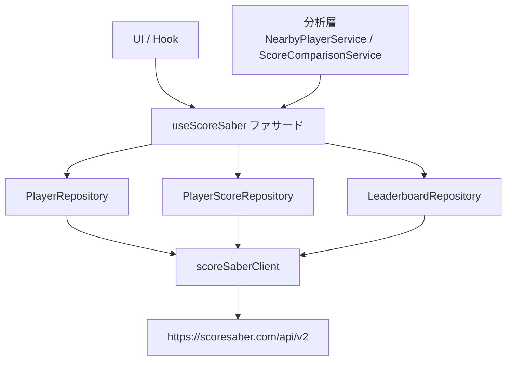

# ScoreSaber API v2 データ取得層

`src/feature/scoresaber/hooks` 配下の実装について、各ファイルの解説と具体的な使用例をまとめたドキュメント。

## ファイル一覧

| ファイル                                                       | 役割                                                                 |
| -------------------------------------------------------------- | -------------------------------------------------------------------- |
| [`scoreSaberClient.ts`](./scoreSaberClient.md)                 | 共有 HTTP クライアント。同時数制限・リトライ・キャッシュ             |
| [`usePlayerRepository.ts`](./usePlayerRepository.md)           | プレイヤー情報・ランキング周辺のプレイヤー取得                       |
| [`usePlayerScoreRepository.ts`](./usePlayerScoreRepository.md) | プレイヤーのスコア取得（トップスコア・個別スコア）                   |
| [`useLeaderboardRepository.ts`](./useLeaderboardRepository.md) | 譜面（Leaderboard）情報と譜面別ランキング取得                        |
| [`useScoreSaber.ts`](./useScoreSaber.md)                       | 3つのリポジトリを束ねるファサード（既存 `searchPlayers` の互換維持） |

## 設計の前提

- **比較の単位は Leaderboard ID**。1つの譜面は「マップ + 難易度 + ゲームモード」の組み合わせで決まり、Leaderboard ID がその組み合わせを一意に表すキーになる。
- **ランキング取得とスコア取得を分離**している。プレイヤー一覧（200人）は少数のリクエストで取れるが、スコアはプレイヤーごとに1リクエスト必要なため、リポジトリを分けている。
- **404 はエラーではなく有効な回答**。`players/{id}/scores/hash/...` で 404 が返ることは「その譜面をプレイしていない」ことを意味する。そのため 404 はリトライ対象から除外し、`null` として扱えるようにしている。

## レイヤー構成



## 共通のレスポンス形状

ページネーション付きエンドポイントは `{ data, metadata }` のEnvelope を返す。単一オブジェクトを返すエンドポイント（`players/{id}`、`leaderboards/{id}`、`players/{id}/scores/hash/...`）は `data` で包まない **フラットなオブジェクト** を返す。この違いは型定義に反映済み（`PaginatedResponse<T>`）。

```ts
interface PaginatedResponse<T> {
  data: T[];
  metadata: {
    page: number;
    itemsPerPage: number;
    totalItems: number;
    totalPages: number;
  };
}
```

## 検証方法

パラメータとレスポンス形状は OpenAPI スキーマ（`https://scoresaber.com/api/openapi.json`）と実レスポンスの両方で確認した。注意点は各ドキュメントの「検証済み事実」に記載している。
